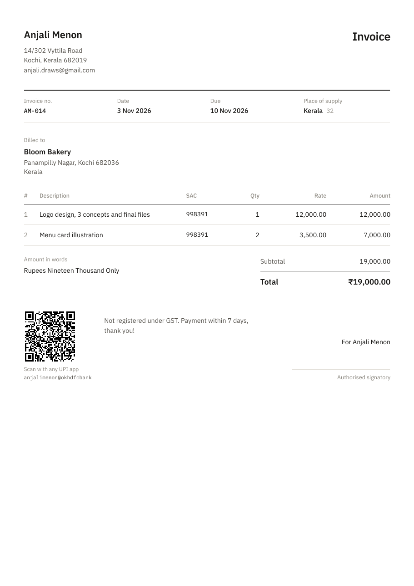
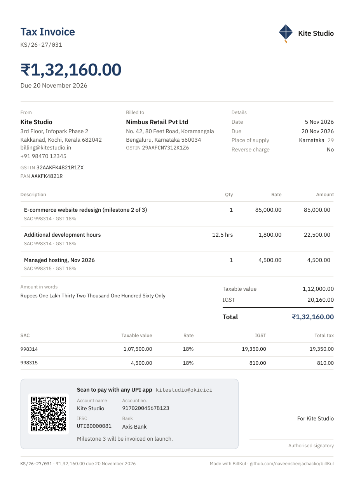
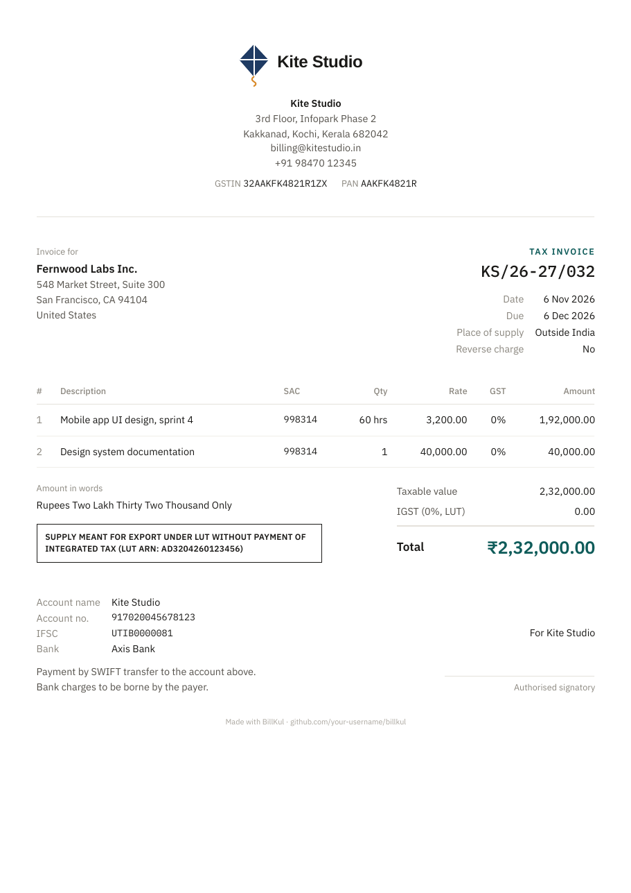
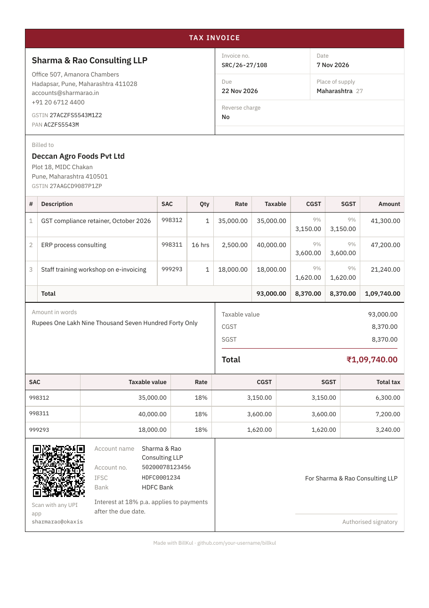

# BillKul

**Free, open-source GST invoices for Indian freelancers.** Runs entirely in your browser. No login, no server, nothing uploaded.

**Try it: [bill-kul.vercel.app](https://bill-kul.vercel.app)**

Free tools on the site: [GST calculator](https://bill-kul.vercel.app/gst-calculator/) · [GSTIN checker](https://bill-kul.vercel.app/gstin-validator/) · [GST invoice format guide](https://bill-kul.vercel.app/gst-invoice-format/) · [Export invoices under LUT](https://bill-kul.vercel.app/export-invoice-lut/)

<a href="https://buymeacoffee.com/naveensheejachacko"></a>

## What it does

- **Gets GST right automatically.** Same state → CGST + SGST (or UTGST in union territories), different state → IGST. Worked out from the GSTINs.
- **Exports done properly.** Foreign client? Zero-rated under LUT with the mandatory declaration and your LUT ARN, or IGST if you don't have an LUT.
- **Not registered for GST?** It makes a plain invoice with no tax.
- **UPI QR on every invoice.** Clients scan it in GPay, PhonePe or Paytm and the exact amount is filled in.
- **GSTIN validation with checksum.** Catches typos before your client's CA does.
- Indian number formatting (₹12,34,567.00), amount in words (“One Lakh Twenty Thousand”), financial-year invoice numbering (`INV/26-27/001`), SAC-wise tax summary.
- Saved clients, paid/unpaid tracking, and JSON backup and restore.

## Four invoice designs

Choose a design and accent colour above the preview. Upload your logo once in *Your details* and it replaces your business name at the top of every invoice.

| Classic | Modern | Minimal | GST boxed |
| --- | --- | --- | --- |
| [](samples/1-classic-freelancer.pdf) | [](samples/2-modern-interstate-igst.pdf) | [](samples/3-minimal-export-lut.pdf) | [](samples/4-gst-boxed-intrastate.pdf) |
| Freelancer without GST | Inter-state, IGST | Export under LUT | Same state, CGST + SGST |

All businesses in the samples are fictional.

## Project layout

```
packages/core   GST engine, published on npm as @billkul/core
apps/web        React app (Vite), static and deployable anywhere
packages/mcp    (coming) MCP server so Claude and other AI assistants can create invoices
```

## Develop

Requires Node 18+.

```bash
npm install
npm run dev        # http://localhost:5173
npm test           # core engine tests
npm run build      # static site in apps/web/dist
```

Deploy `apps/web/dist` to Netlify, Vercel, Cloudflare Pages or GitHub Pages. It's just static files.

## Use the GST engine in your own code

The same tested engine is published on npm as [`@billkul/core`](packages/core): GSTIN and PAN validation, CGST/SGST/IGST calculation, full GST invoices (including exports under LUT), amount in words with lakh and crore, and UPI payment links and QR codes.

```bash
npm install @billkul/core
```

```ts
import { validateGstin, calculateGst, formatINR } from "@billkul/core";

validateGstin("27AAPFU0939F1ZV").stateName;      // "Maharashtra"
formatINR(calculateGst(10000, 18).totalPaise);   // "₹11,800.00"
```

See the [package README](packages/core#readme) for the full API.

## Disclaimer

BillKul helps you make correct-looking invoices but it is not tax advice. Check anything unusual with your CA.

## Support

If BillKul saves you time every month, [buy me a coffee ☕](https://buymeacoffee.com/naveensheejachacko). It keeps the project free.

## License

MIT
